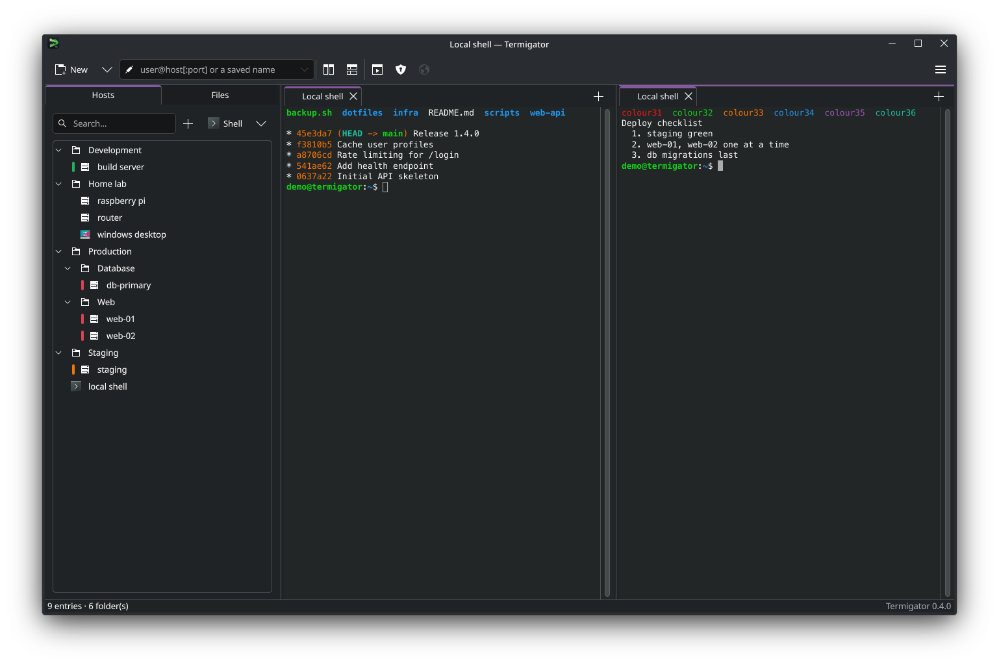
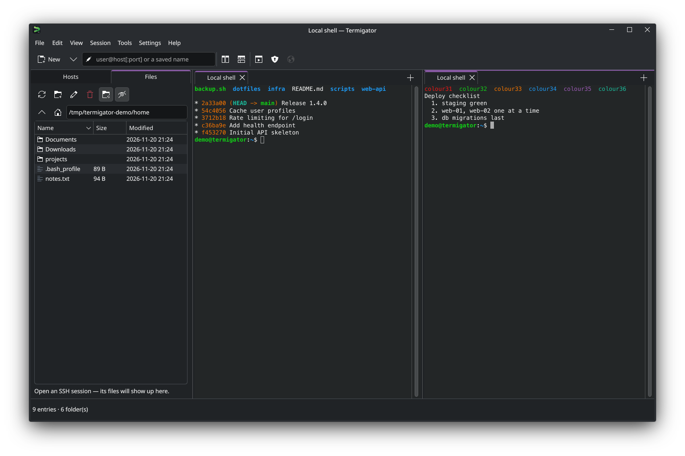

# Termigator


A lightweight SSH launcher and terminal for your desktop: saved connections in a folder tree, an
embedded terminal (built on Ghostty's terminal engine) or an external Konsole window, an SFTP-style
file sidebar, tunnels, and RDP / VNC / telnet / serial launching. Written in Rust with Qt 6 (cxx-qt,
QML, KF6).

**Platform:** Linux (developed and tested on KDE Plasma 6; other desktops work with the KDE
frameworks installed) and Windows 11 x64 (installer with its own Qt and KF6; tested on Windows 11).





## Features

- **Connections:** SSH (optionally over mosh), RDP (FreeRDP), VNC (TigerVNC), telnet and serial,
  plus favourite commands.
  Nested folders (`prod/web/eu`), drag & drop, search (`Ctrl+Shift+H`), duplicate, copy the exact
  `ssh` command (password masked), quick connect (`Ctrl+Shift+O` or the toolbar field, with a history).
  Folders are renamed, moved and deleted from the tree; the tree works from the keyboard (`F2`,
  `Delete`, `Ctrl+C` / `Ctrl+X` / `Ctrl+V`, `Ctrl+N`). **Add to Hosts…** on a tab saves an open connection.
- **Embedded terminal:** Ghostty's VT engine (`ghostty-vt`) with tabs, nested split panes,
  detachable tabs, find, zoom, snippets, session logging, asciinema recording, MultiExec and
  broadcast to all live sessions. Follows your Konsole profile (colour scheme and font) unless you
  override it. Mouse-aware programs (vim, tmux, mc, htop, k9s) get the wheel and drags; a dragged
  selection scrolls the view; the zoom stays with a tab when it is split, moved or detached.
  An external terminal (Konsole or any `launch.template`) is available per entry.
- **Session handling:** a stopped session keeps its tab and offers restart / close / save output;
  optional auto-reconnect with back-off; SSH keepalive; optional disconnect notification.
- **Files panel:** SFTP-style sidebar that follows the active SSH tab and reuses its connection
  (OpenSSH ControlMaster, so no second login), two-pane local / remote view, drag & drop transfers,
  folder synchronisation with a plan you review first, and both panes work from the keyboard.
- **SSH features:** jump hosts, local / remote / dynamic forwards, agent and X11 forwarding, key
  manager (generate, copy, add to agent, install on a host), a separate private key per tunnel and
  for the jump host, connection test without logging in,
  network tools (ping, traceroute, DNS, port check, port scan).
- **Secrets:** saved passwords are stored in plain text unless you set a master password
  (scrypt + AES-GCM); the master password is asked once per run and only when needed.
- **Import / export:** MobaXterm, PuTTY, SuperPuTTY (Windows), Remmina (Linux) and `~/.ssh/config`;
  backup export.
- **Desktop integration:** KDE look and feel (identical look elsewhere), global show / hide through
  `termigator --toggle` (bind it in System Settings → Shortcuts), `termigator --show`. With the tray
  icon on, closing the window asks whether to hide it in the tray or exit (the answer can be remembered).
  One instance per user: starting Termigator again brings the running window forward, also from the
  tray (Settings → Application → *Allow only one application instance* turns it off).
- **Update check:** once a day at startup, a banner when GitHub has a newer release (nothing is
  downloaded; the request tells GitHub only your IP address). Chosen in the welcome window,
  switched off in **Settings → Configure Termigator… → Application**.

## Download

Ready-made packages are attached to each [GitHub release](https://github.com/Ernold11/Termigator/releases):

| File | For |
|---|---|
| `termigator_<version>_ubuntu26.04_amd64.deb` | Ubuntu 26.04 (uses the system's Qt 6 and KF6) |
| `termigator_<version>_mint22.3_amd64.deb` | Linux Mint 22.x, Ubuntu 24.04 (carries its own Qt and KF6 in `/opt/termigator`) |
| `Termigator-<version>-x86_64.AppImage` | other distributions (needs FUSE 2) |
| `termigator-<version>-1-x86_64.pkg.tar.zst` | Arch Linux |
| `termigator-<version>-setup.exe` | Windows 11 x64 (not signed, so SmartScreen asks before the first start) |

Check the download against `SHA256SUMS` from the same release (`sha256sum -c SHA256SUMS --ignore-missing`).
The `*-sources.tar` files there are the sources of the libraries the AppImage, the Mint package and the
Windows installer carry.

```bash
sudo apt install ./termigator_*_ubuntu26.04_amd64.deb    # Ubuntu 26.04 (or the mint22.3 file on Mint)
sudo pacman -U termigator-*-x86_64.pkg.tar.zst           # Arch Linux
chmod +x Termigator-*-x86_64.AppImage && ./Termigator-*-x86_64.AppImage
```

## Install from source

The packages above are built with these scripts; you can build any of them yourself.

**Ubuntu 26.04 — native package.** Built in a podman container so it links against Ubuntu's own Qt 6
and KF6; the build tools (including Rust) are not needed to run it:

```bash
scripts/make-deb.sh                       # target/deb/termigator_<version>_ubuntu26.04_amd64.deb
sudo apt install ./target/deb/termigator_*_ubuntu26.04_amd64.deb
```

**Linux Mint 22.x / Ubuntu 24.04 — bundled package.** These ship Qt 6.4 and no KF6, so the package
carries Qt, KF6 and glibc under `/opt/termigator` (the same tree as the AppImage, no FUSE needed). Built in
an Ubuntu 26.04 container on any host with podman or docker, then install-tested in a Mint 22.3 container:

```bash
scripts/make-deb.sh --bundled             # target/deb/termigator_<version>_mint22.3_amd64.deb
sudo apt install ./termigator_*_mint22.3_amd64.deb    # on the Mint machine
```

**Any distribution — AppImage** (carries Qt, KF6 and glibc; the GPU stack comes from the host; needs
FUSE 2, e.g. `libfuse2t64` on Ubuntu 24.04+). Build on an Arch or Debian/Ubuntu host with Qt 6, KF6, `appimagetool` and `python3` (collects the licences):

```bash
scripts/make-appimage.sh                  # target/appimage/Termigator-x86_64.AppImage
scripts/make-deb.sh --appimage            # the same, built in a container (podman/docker only)
scripts/install-appimage.sh               # ~/.local/bin, menu entry and icons for your user
scripts/install-appimage.sh --uninstall
```

**Arch Linux — native package.** Built from the last commit with `packaging/arch/PKGBUILD` in an
archlinux container (podman or docker), then installed and smoke-tested in a clean one:

```bash
scripts/make-arch.sh                      # target/arch/termigator-<version>-1-x86_64.pkg.tar.zst
sudo pacman -U target/arch/termigator-*-x86_64.pkg.tar.zst
```

**Windows 11 — installer** (`termigator-<version>-setup.exe`; for the current user without administrator
rights, or for all users). It carries Qt, KF6, the Breeze colour schemes, fonts and dark icons; the configuration
lives in `%APPDATA%\termigator`. To build it you need, on Windows, Rust (MSVC), the MSVC Build Tools,
[KDE Craft](https://community.kde.org/Craft) with `kde/frameworks/tier1/kirigami` and
`kde/frameworks/tier3/qqc2-desktop-style`, and Inno Setup 6; the colour schemes, fonts and dark Breeze
icons, and the licence texts of everything the installer carries, are collected on an Arch Linux machine first (needs breeze-icons, Qt 6's `rcc` and `python3`):

```bash
scripts/windows-share.sh share            # on Linux; copy the share folder to the Windows machine
```

```powershell
powershell -ExecutionPolicy Bypass -File scripts\make-windows-installer.ps1 -Share C:\path\to\share
# -> dist\windows\termigator-<version>-setup.exe
```

**From source** (builds the last commit and installs it for your user; `--uninstall` removes it):

```bash
./install.sh
```

## Build and develop

Requirements: **Rust 1.99+**, **Qt 6.10+** (Quick Controls, QML), **KF6** (Kirigami, qqc2-desktop-style,
Breeze, Notifications, GlobalAccel, WindowSystem, ColorScheme, IconThemes), `lld` or another linker,
**Zig 0.17.x** (the terminal engine, `ghostty-vt`, is built from a pinned release). Run
`scripts/fetch-ghostty.sh` once to put that release in `~/.cache/ghostty-vt-release`; after that
`cargo build` needs no network.

```bash
cargo build --release
./target/release/termigator                  # or ./run-termigator.sh

export QT_QPA_PLATFORM=offscreen
cargo fmt --all --check
cargo clippy --workspace --all-targets -- -D warnings
cargo test --workspace
scripts/qmllint.sh
```

Layout:

| Path | Role |
|---|---|
| `crates/termigator-core/` | Logic without Qt: config (YAML with comments), vault, command builders, import parsers, PTY and processes, file listing and sync. |
| `crates/termigator/` | The application: QML (`qml/`), thin QObjects (`src/*_qobj.rs`) and Qt glue. |
| `crates/termigator-term-bridge/` | Qt view and session objects (cxx) on the Ghostty engine in Rust. |
| `config/*.example.yaml` | Configuration templates. |
| `compat/` | Golden JSON files and tools used by the tests. |
| `packaging/` | Arch `PKGBUILD` and the Windows installer script (Inno Setup). |
| `scripts/` | Packaging (`make-deb.sh`, `make-appimage.sh`, `install-appimage.sh`, `make-arch.sh`, `make-windows-installer.ps1`), distro checks, qmllint. |

## Configuration

Config lives in `~/.config/termigator/` (or `TERMIGATOR_CONFIG_DIR`); the directory is created with mode 0700
and the YAML files with 0600. You do not need to write it by hand: the app creates `session.yaml` when you
save a connection and `config.yaml` when you change a setting, and **File → Import** reads MobaXterm, PuTTY, Remmina and
`~/.ssh/config`. The commented templates in `config/` document every field:

- `config.yaml` — `window.*`, `launch.*` (external terminal template, `TERM`, scrollback, font, colour
  scheme, keepalive, probe timeout), favourites, the `vault:` parameters.
- `session.yaml` — the connection list (SSH, RDP, VNC, …). Each entry may set `terminal: embedded`
  or `external`. Every field is documented in `config/session.example.yaml`.

Most settings are also in **Settings → Configure Termigator…**. For an SSH entry, `identity_file` must be
the private key; with a key set Termigator passes `-o IdentitiesOnly=yes`. A tunnel can have its own
`identity_file`, and `jump_identity_file` gives the entry's jump hosts their own key. Encrypted keys need an unlocked
agent (`ssh-add`).

## Runtime dependencies

- **OpenSSH ≥ 9.0** (`ssh`, `scp`, `sftp`; older `scp -r` has CVE-2019-6111)
- **Konsole** (or change `launch.template`) for external mode; `bash`
- Optional: `sshpass` (saved passwords), FreeRDP (`xfreerdp3` / `xfreerdp`) for RDP, TigerVNC for VNC,
  `telnet`, `picocom` / `tio` / `screen` for serial, GNU `find` on servers (folder sync), `mtr` /
  `nmap` / `dig` for the network tools

## Troubleshooting

- **"Termigator cannot start: the configuration could not be read."** `config.yaml` or `session.yaml`
  has a YAML error; the window names the file and line. Fix or move the file (**Open folder**), then start
  again. Nothing is changed or overwritten.
- **"Password is set but sshpass is not in PATH".** Install `sshpass` (Linux) or use an SSH key. Windows needs
  no `sshpass`.
- **The Files panel or the connection test fails with a passphrase-protected key.** Only the terminal can
  ask for a passphrase; background connections cannot. Add the key to your agent (`ssh-add`, or
  **Tools → SSH keys… → Add to agent**).
- **"UNPROTECTED PRIVATE KEY FILE" / "bad permissions" for a key.** Other users can read the key file,
  so OpenSSH ignores it. Termigator then gives ssh a private copy (in its runtime folder) and says so; to
  fix the file itself, `chmod 600` it (Linux) or leave only your account in Properties → Security (Windows).
- **The AppImage does not start** ("cannot mount", "fuse"). Install FUSE 2 (`libfuse2t64` on Ubuntu 24.04+,
  `fuse2` on Arch) or use the bundled `.deb`.
- **The Files panel cannot synchronise a folder.** Folder sync needs GNU `find` on the server (BusyBox
  `find` lacks `-printf`).
- **The global show / hide shortcut does nothing.** Bind `termigator --toggle` in System Settings →
  Shortcuts; on Wayland only the desktop can grab global keys.
- **Anything else.** Start it from a terminal (`termigator`, or `./run-termigator.sh` in a checkout, which
  also writes `/tmp/termigator.log`) and attach the output to an issue — without host names or passwords.

## Known limitations

- Saved passwords are stored in plain text (files readable only by you) until you set a master
  password in **Tools → Master password…**.
- Mosh entries cannot use a saved password (use a key).
- Windows: no port scan in the network tools, serial lines need `plink` (PuTTY), no external-terminal mode
  (Konsole is Linux-only).
- Linux desktops other than KDE Plasma work with the KDE frameworks installed but get less testing.
- Only x86-64 packages are built.

## Contributing

Bug reports and pull requests are welcome: see [CONTRIBUTING.md](CONTRIBUTING.md) and the
[Code of Conduct](CODE_OF_CONDUCT.md). Report security problems privately, as described in
[SECURITY.md](SECURITY.md). Changes are listed in [CHANGELOG.md](CHANGELOG.md).

## License

Termigator's own code is MIT (`LICENSE`). The binary also links permissively licensed third-party
code: Ghostty's terminal engine (libghostty-vt, MIT; its Rust wrapper `ghostty-vt`, Apache-2.0), other
Rust crates (MIT, Apache-2.0, BSD, ISC, Zlib, one MPL-2.0) — every package carries their texts in
`THIRD-PARTY-RUST.txt`. Qt and the KDE Frameworks (LGPL) are linked dynamically; the packages that carry
them (AppImage, the Mint package, the Windows installer, which also carries Microsoft's Visual C++ runtime)
include their licences, and their sources are published with each release (`SOURCES.txt`). The logo was
made for this project with an image generator (ChatGPT). Distribution logos come from Simple Icons
(CC0-1.0). See `LICENSES/README.md` and `ARCHITECTURE.md` (ADR-14).

MobaXterm, PuTTY, SuperPuTTY, Remmina, Konsole and the distribution names and logos are trademarks or
names of their respective owners. Termigator is not affiliated with or endorsed by them; it names them
only to say which session files it can import and which programs it works with.
